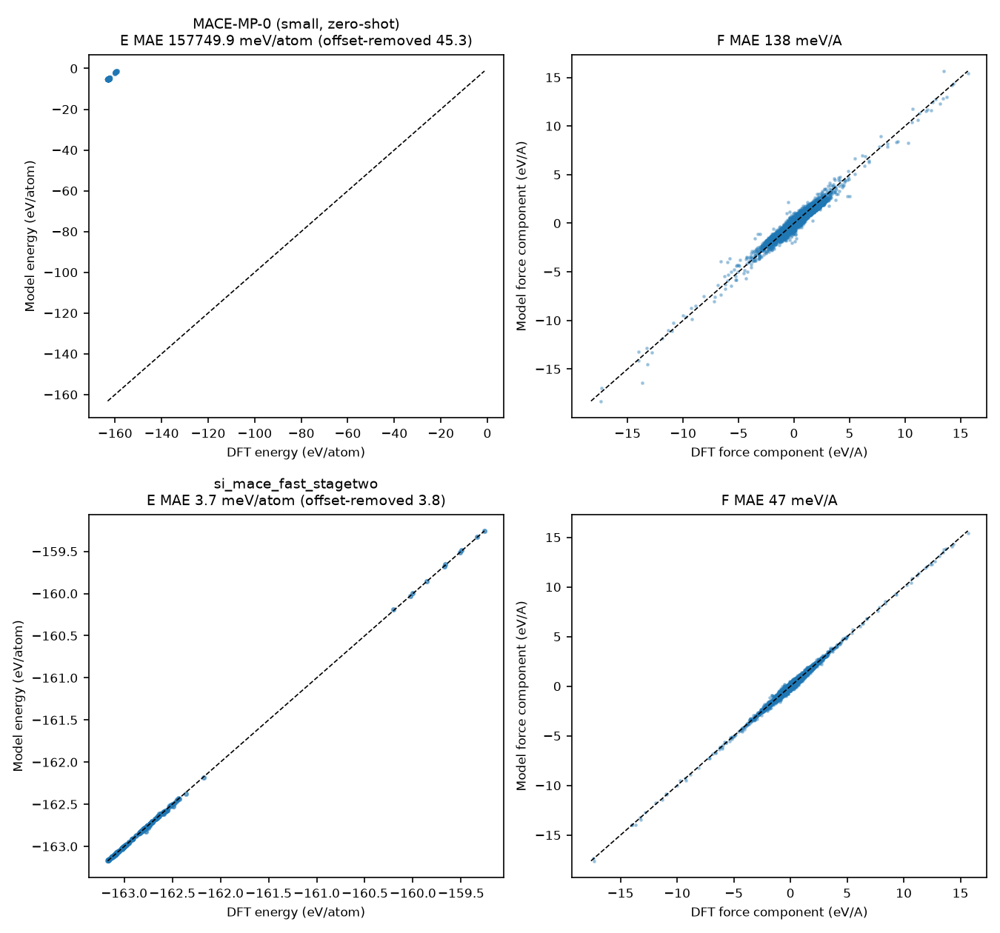
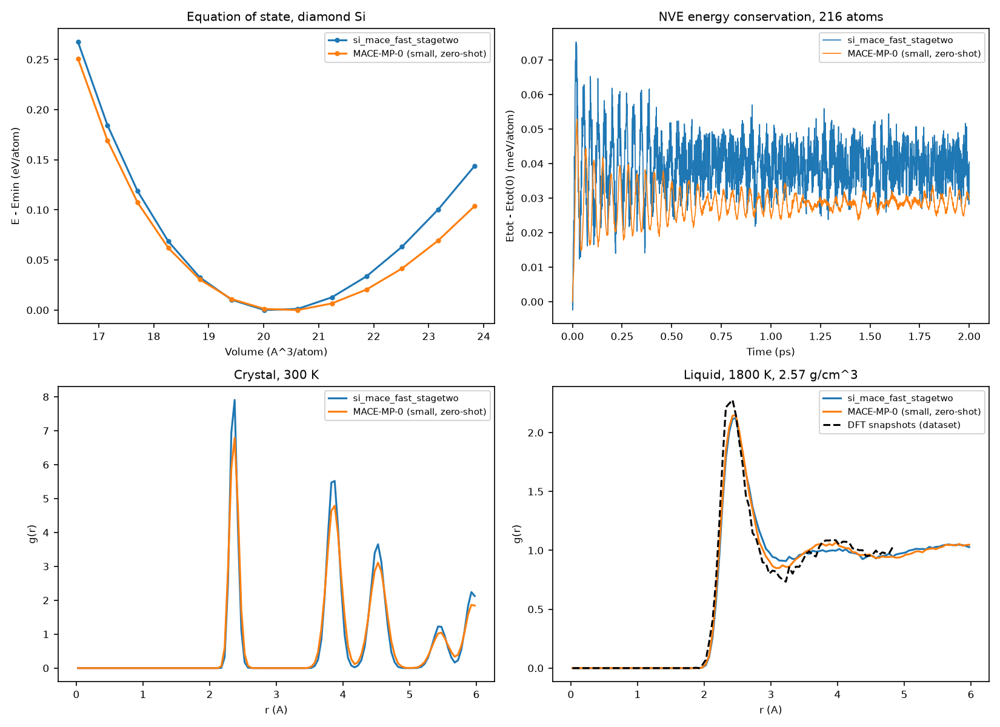
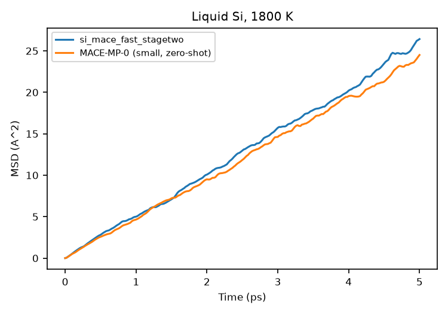

# A MACE interatomic potential for silicon

Training and validating a machine-learned interatomic potential (MLIP) with
[MACE](https://github.com/ACEsuit/mace) on the public Si GAP-18 DFT dataset,
compared with the MACE-MP-0 foundation model used zero-shot.

## Summary

A small MACE model (64 channels, L=0) trained for 60 epochs (~33 min on one
NVIDIA RTX 3050) reduces test-set errors relative to zero-shot MACE-MP-0 by
about 12× for energies and 3× for forces. In MD it conserves energy, reproduces
the diamond lattice constant and bulk modulus, and gives a liquid structure
close to the DFT reference.

## Results

### Test-set errors (249 held-out structures, 26 structure types)

| Metric | This model | MACE-MP-0 (small, zero-shot) |
|---|---|---|
| Energy MAE | **3.8 meV/atom** | 45.3 meV/atom* |
| Force MAE | **46.6 meV/Å** | 137.9 meV/Å |
| Force RMSE | **74.7 meV/Å** | 192.2 meV/Å |
| Force MAE, diamond | 10.7 meV/Å | 69.2 meV/Å |
| Force MAE, sp (dimers/chains) | 97.0 meV/Å | 734.1 meV/Å |

\* After removing a constant per-atom offset. MACE-MP-0 was trained on
Materials Project (VASP/PBE) energies, which use a different energy reference
from the CASTEP/PW91 data here (raw offset ≈ 158 eV/atom).

Largest remaining errors for this model are on surfaces, cracks and liquid
(~100–113 meV/Å); bulk crystalline phases are at 10–40 meV/Å.



### MD validation (ASE, 216 atoms, 1 fs timestep)

| Quantity | This model | MACE-MP-0 | Reference |
|---|---|---|---|
| Lattice constant a₀ | 5.451 Å | 5.460 Å | 5.431 Å (expt.) |
| Bulk modulus B₀ | **95.7 GPa** | 77.3 GPa | ~98 GPa (expt.) |
| NVE energy drift, 2 ps | −5×10⁻⁵ meV/atom/ps | 2×10⁻⁴ meV/atom/ps | 0 |
| Liquid (1800 K) first RDF peak | 2.475 Å | 2.475 Å | 2.425 Å (DFT snapshots) |
| Liquid coordination, r < 3.0 Å | 5.72 | 5.69 | 5.51 (DFT snapshots) |
| Liquid self-diffusion D | 0.88×10⁻⁴ cm²/s | 0.80×10⁻⁴ cm²/s | — |
| MD wall time (all tests) | 5.8 min | 13.3 min | — |

Key observations:

- Both models conserve energy in NVE (fluctuations < 0.1 meV/atom, no drift).
- The trained model is stiffer than MACE-MP-0 (B₀ 95.7 vs 77.3 GPa), consistent
  with the known softening of foundation-model potential energy surfaces.
- Crystal RDF peaks fall at 2.35, 3.84 and 4.50 Å, as expected for diamond Si.
- The liquid is slightly less structured than the DFT reference (coordination
  ~4% high, shallower first minimum), matching the higher liquid force errors.




### Limitations

- Short runs (2–5 ps) in a 216-atom cell; diffusion coefficients are approximate.
- Liquid simulated in NVT at a fixed experimental density (2.57 g/cm³), not NPT.
- The DFT liquid reference comes from small dataset cells whose temperatures
  and densities may differ from the MD conditions, so it is an approximate comparison.
- Single model, single seed; no uncertainty estimate.

### Next steps

- Longer training and an equivariant (L=1) model to reduce surface and liquid errors
- Fine-tuning MACE-MP-0 on this dataset and comparing with training from scratch
- LAMMPS deployment for larger, longer simulations
- Applying the workflow to a new system with Quantum ESPRESSO-generated training data

## Data

Si GAP-18 training database: A. P. Bartók, J. Kermode, N. Bernstein, G. Csányi,
"Machine Learning a General-Purpose Interatomic Potential for Silicon,"
*Phys. Rev. X* **8**, 041048 (2018). Data: University of Cambridge repository,
[doi:10.17863/CAM.65004](https://doi.org/10.17863/CAM.65004) (`Si_PRX_GAP.zip`).

The dataset is not redistributed here. Download it and use the training `.xyz`
file, which contains `dft_energy`, `dft_force` and `dft_virial` labels. (The
ColabFit copy of this dataset does not include forces.)

## Reproducing

### Environment

```bash
conda create -n mlip python=3.11 -y
conda activate mlip
pip install torch --index-url https://download.pytorch.org/whl/cu128   # match your CUDA driver
pip install mace-torch ase matplotlib
python -c "import torch; print(torch.cuda.is_available())"
```

Consumer GeForce GPUs are slow in float64, so `common.py` loads models in
float32 for evaluation and MD.

### Steps

```bash
# 1. Prepare data: label cleanup, isolated-atom E0, stratified 90/10 split
python 01_prepare_data.py gap18.xyz --out data

# 2. Zero-shot baseline
python 02_evaluate.py data/test.xyz --models mp:small --out results_zeroshot

# 3. Train (60 epochs, Stage Two from epoch 45)
EPOCHS=60 SWA_START=45 bash 03_train.sh

# 4. Test-set comparison
python 02_evaluate.py data/test.xyz --models mp:small models/si_mace_fast_stagetwo.model

# 5. MD validation
python 04_md_validate.py --models models/si_mace_fast_stagetwo.model mp:small \
                         --ref-xyz data/train.xyz
```

Training logs are written to `logs/*.log`. MACE saves two models: use
`models/si_mace_fast_stagetwo.model` (end of Stage Two, best energies), not
`si_mace_fast.model` (best Stage One checkpoint).

### Training settings

| Setting | Value |
|---|---|
| Model | MACE, 64 channels, max_L = 0, correlation order 3 |
| Cutoff | 5.0 Å |
| Loss weights (energy / forces / stress) | 1 / 10 / 1, then 1000 / 100 / 10 in Stage Two |
| Optimizer | AMSGrad, lr 0.01, EMA decay 0.99 |
| Batch size | 5 |
| Epochs | 60 (Stage Two from epoch 45) |
| Precision | float32 |
| Hardware | 1× NVIDIA RTX 3050, ~33 s/epoch |

## Files

| File | Purpose |
|---|---|
| `common.py` | Loads a trained model or MACE-MP-0 (`mp:small/medium/large`) |
| `01_prepare_data.py` | Label detection, E0 extraction, stratified split, data summary |
| `02_evaluate.py` | Energy/force errors, per-structure-type errors, parity plots |
| `03_train.sh` | MACE training (`fast` and `better` presets) |
| `04_md_validate.py` | EOS, NVE drift, crystal and liquid RDF, diffusion |
| `slurm_gpu.sh` | Example SLURM job script for an HPC cluster |
| `results/` | Error tables, validation JSON and plots |
